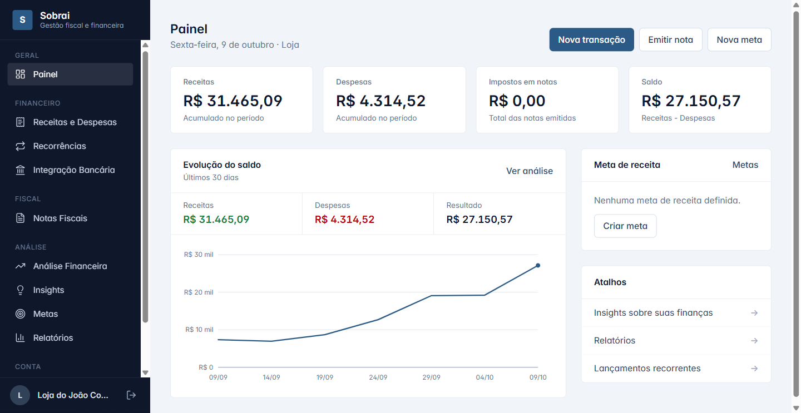
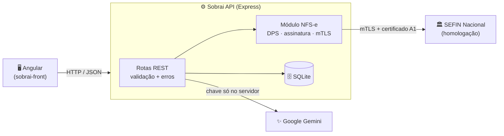
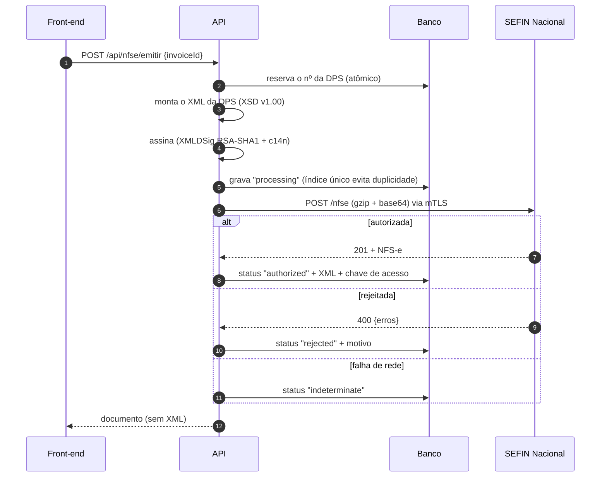

<div align="center">

<br>

# ⚙️ Sobrai API

### Back-end do Sobrai: financeiro, notas fiscais e **emissão de NFS-e Nacional**

API REST em Node.js com SQLite, validação em todas as rotas e uma integração fiscal com assinatura digital e mTLS.

<br>


[**← Front-end do Sobrai**](https://github.com/joaofelipex/sobrai-front)

<br>



</div>

<br>

## 📑 Sumário

[Visão geral](#-visão-geral) · [Endpoints](#-endpoints) · [NFS-e Nacional](#-nfs-e-nacional) · [Segurança](#-segurança) · [Como rodar](#-como-rodar) · [Testes](#-testes) · [Estrutura](#-estrutura) · [Limitações](#-limitações-conhecidas)

<br>

## 🔭 Visão geral



**Decisões de projeto**
- **Validação na borda:** toda rota valida tipos, enums e valores antes de tocar o banco, devolvendo `400` com a mensagem do campo errado.
- **Erros centralizados:** um *middleware* único converte falhas em respostas; nada fica pendurado nem vaza detalhes internos.
- **Integridade no servidor:** cliente com notas não é excluído (`409`); nota com NFS-e autorizada não é apagada nem cancelada "por fora".
- **Migrações idempotentes** na subida, e uma única conexão SQLite compartilhada.
- **IDs UUID** (`crypto.randomUUID`) no lugar de `Date.now()`, que colidia em requisições simultâneas.

<br>

## 📡 Endpoints

| Recurso | Rotas | Observações |
|---|---|---|
| `/api/transactions` | `GET` `POST` `PUT /:id` `DELETE /:id` | Receitas e despesas; guarda o vínculo com a nota (`invoiceId`) |
| `/api/clients` | `GET` `POST` `PUT /:id` `DELETE /:id` | `409` se o cliente tiver notas |
| `/api/goals` | `GET` `POST` `PUT /:id` `DELETE /:id` | Metas de faturamento ou economia |
| `/api/invoices` | `GET` `POST` `PATCH /:id` `DELETE /:id` | `PATCH` altera o status; `DELETE` remove também a receita gerada |
| `/api/recurring` | `GET` `POST` `PUT /:id` `DELETE /:id` | Lançamentos mensais |
| `/api/company-profile` | `GET` `POST` `PUT` | `PUT` faz *upsert* |
| `/api/insights` | `POST` | Recomendações via Gemini (chave só no servidor) |
| `/api/fiscal` | `GET /status` · `GET/PUT /settings` · `GET/PUT/DELETE /certificate` | Dados fiscais e certificado A1 |
| `/api/nfse` | `GET` · `POST /emitir` · `POST /:id/cancelar` · `GET /:id/xml` | Emissão, cancelamento e XML |

<br>

## 🏛️ NFS-e Nacional

Integração direta com a SEFIN Nacional, sem intermediário pago.



**O que está implementado**
- XML da **DPS** e do **evento de cancelamento** gerados a partir dos XSDs oficiais (v1.00) e **validados contra eles nos testes**.
- Assinatura **XMLDSig** conforme o schema (RSA-SHA1, c14n inclusiva, *enveloped*) e comunicação por **mTLS** com certificado A1.
- Estados `processing → authorized | rejected | indeterminate → canceled`. Falha de rede **nunca** vira "rejeitada": a nota fica "indeterminada" para não emitir em duplicidade.
- Número da DPS reservado de forma atômica (`UPDATE … RETURNING`) e nunca reaproveitado.

> [!IMPORTANT]
> Testado de ponta a ponta contra uma **SEFIN simulada** (mTLS, emissão, rejeição, cancelamento, duplicidade). **Ainda não foi validado contra o ambiente real de homologação**, que exige um certificado ICP-Brasil. Dois detalhes vieram de fontes da comunidade e devem ser conferidos no Swagger oficial: a URL de homologação e o nome do campo JSON do evento de cancelamento.

<br>

## 🔐 Segurança

| Medida | Como |
|---|---|
| Certificado e senha | Guardados **criptografados** (AES-256-GCM) com chave derivada de `NFSE_SECRET`; nunca voltam ao navegador |
| Ambiente | **Homologação por padrão**; produção só com `NFSE_AMBIENTE=1` **e** `NFSE_ALLOW_PRODUCTION=true` |
| TLS | Validação do servidor sempre ligada; cadeia ICP-Brasil via `NFSE_CA_FILE` |
| Chave do Gemini | Só no servidor, em variável de ambiente (fora do bundle do front) |
| CORS | Aberto em desenvolvimento; restrito com `CORS_ORIGIN` |
| Segredos no Git | `.env` e `*.db` ignorados |

<br>

## 🚀 Como rodar

> **Pré-requisito:** Node.js 20.12 ou superior.

```bash
git clone https://github.com/joaofelipex/sobrai-back.git
cd sobrai-back
npm install
cp .env.example .env     # opcional
npm run dev              # http://localhost:3001
node seed.js             # dados de exemplo (não apaga nada)
```

<details>
<summary><b>⚙️ Variáveis de ambiente (<code>.env</code>)</b></summary>

<br>

| Variável | Para quê |
|---|---|
| `GEMINI_API_KEY` | Habilita os insights com IA. Sem ela, o front mostra recomendações de exemplo |
| `NFSE_SECRET` | Senha (mín. 16 caracteres) que criptografa o certificado no banco |
| `NFSE_AMBIENTE` / `NFSE_ALLOW_PRODUCTION` | Produção da NFS-e (exige as duas). Padrão: homologação |
| `NFSE_CA_FILE` | Cadeia ICP-Brasil (`.pem`), se a validação TLS da SEFIN falhar |
| `CORS_ORIGIN` | Origens aceitas pela API (separadas por vírgula) |
| `PORT` | Porta da API (padrão `3001`) |

</details>

Para ver a interface, rode também o [front-end](https://github.com/joaofelipex/sobrai-front).

<br>

## 🧪 Testes

```bash
npm test
```

São **7 testes** (`node:test`):

- XML da DPS válido no **XSD oficial** (MEI com tomador; Simples sem tomador)
- DPS assinada: valida no XSD, a assinatura confere e **adulteração é detectada**
- Evento de cancelamento assinado válido no XSD
- Certificado com senha errada ou vencido é recusado
- Criptografia do segredo (e exigência de `NFSE_SECRET`)
- **Fluxo completo** com o backend real em outro processo e uma SEFIN falsa em HTTPS com mTLS: configuração, certificado (senha errada e CNPJ divergente), rejeição, emissão, bloqueio de duplicidade e cancelamento

<br>

## 🗂️ Estrutura

```
.
├── index.js                 # app Express e rotas
├── database.js              # conexão SQLite e migrações
├── seed.js                  # dados de exemplo
├── routes/                  # transactions, clients, goals, invoices, recurring,
│                            # company-profile, insights, fiscal, nfse
├── lib/
│   ├── http.js              # validação, erros e helpers
│   └── nfse/
│       ├── dps.js           # XML da DPS e do cancelamento
│       ├── sign.js          # assinatura XMLDSig
│       ├── certificate.js   # leitura do certificado A1 (.pfx)
│       ├── secret-store.js  # criptografia AES-256-GCM
│       ├── sefin.js         # cliente HTTPS com mTLS
│       └── schemas/         # XSDs oficiais da NFS-e Nacional v1.00
└── test/
```

<br>

## ⚠️ Limitações conhecidas

- **Sem autenticação:** as rotas de certificado exigem login antes de qualquer uso na internet.
- **NFS-e:** só o leiaute v1.00 e serviços simples; sem substituição de nota, retenções e exportação.
- Dados em SQLite local: para produção, use volume persistente ou outro banco.

<br>

<div align="center">

Feito por [@joaofelipex](https://github.com/joaofelipex)

</div>
